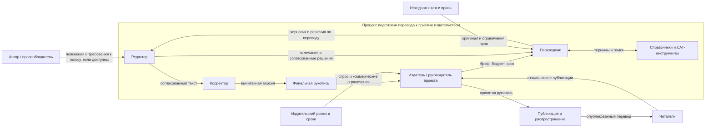

# Лабораторная работа 1. Границы и цель системы

**Тема:** перевод книг с сохранением стиля

## Записка о системе

**Система.** Рассматривается существующий процесс издательской подготовки перевода книги: издатель или руководитель проекта ставит задачу и передаёт материалы переводчику; переводчик исследует оригинал и создаёт перевод; редактор согласует решения с переводчиком; корректор вычитывает утверждённый текст; издатель принимает финальную рукопись. Система существует, чтобы подготовить к публикации полный перевод, который передаёт смысл оригинала, сохраняет согласованные особенности авторского стиля и читается естественно на языке перевода. Это описание работы людей и их взаимодействия «как есть», а не будущего продукта.

**Граница.** **Внутри:** постановка издательской задачи, перевод, исследование терминов, редакторские итерации, корректура, ведение версий и приёмка финальной рукописи. Справочники и CAT-инструменты — средства, которыми пользуются участники внутри процесса, а не самостоятельные заинтересованные стороны. **Снаружи, но влияет:** исходная книга, автор и правообладатель (задают содержание, права и иногда комментарии), читатели и рынок (формируют ожидания и коммерческие ограничения). Спорный элемент — автор: он может влиять на решения, но не является обязательным участником перевода каждой книги, поэтому находится во внешней среде; его комментарии входят в систему как входная информация. **Вне границы и не рассматривается:** маркетинговая кампания и распространение после передачи принятой рукописи, а также личные дела участников: они не выполняют работу по подготовке перевода.

**Цель и признаки достижения.** Цель — передать издательству готовую к публикации рукопись полного перевода, которая сохраняет согласованные особенности авторского стиля и не искажает смысл оригинала. Цель достигнута, если издатель принял финальную версию, в реестре правок не осталось открытых критических замечаний, а переводчик и редактор отметили согласованные признаки стиля на заранее выбранных фрагментах (например, голос повествователя, регистр, ритм и характерная лексика). Проверяемые свидетельства — версия рукописи с отметкой о приёмке, закрытый список критических правок и заполненная оценка стилевых признаков. Срок и бюджет фиксируются как ограничения процесса, но сами по себе не доказывают качество перевода.

## Контекстная диаграмма

## Заинтересованные стороны

| Сторона | Чего хочет | Где цель может расходиться с другими |
|---|---|---|
| Переводчик | Точно передать смысл и голос автора; иметь время на исследование и последовательные решения | Дополнительное время и свобода решений могут конфликтовать со сроком, бюджетом и редакторской унификацией |
| Редактор | Получить ясный, грамотный и цельный текст, соответствующий издательскому стилю | Нормализация текста может ослабить авторские особенности, которые переводчик старается сохранить |
| Издатель / руководитель проекта | Выпустить рукопись вовремя и в рамках бюджета, обеспечить качество и продажи | Срок и стоимость могут ограничивать число итераций и глубину стилистической работы |
| Автор / правообладатель | Сохранить смысл, тон и узнаваемый голос оригинала; соблюсти права | Буквальная близость оригиналу может спорить с естественностью перевода и читабельностью |
| Корректор | Устранить опечатки, грамматические и технические ошибки в финальной версии | Поздние содержательные правки могут возвращать текст на повторную вычитку и сдвигать выпуск |
| Читатель | Получить понятную, увлекательную книгу, которая звучит естественно на его языке | Ожидания аудитории могут отличаться от авторского голоса или издательского решения о степени адаптации |

## Три наблюдения из похода в систему

**Статус:** фактические заметки о походе не предоставлены. Поэтому пункты ниже — не результаты наблюдений, а заготовки-гипотезы. Для сдачи укажите в каждом, что конкретно увидели или услышали, у кого и в какой ситуации; затем оставьте только подтверждённые случаи.

1. **Проверить:** возвращается ли переводчик к уже переведённым главам при уточнении термина или голоса персонажа. **Чем может удивить:** стилевое решение в одной главе влияет на согласованность всей книги. **Факт из похода:** [кто, что делал/сказал, пример].
2. **Проверить:** возникал ли конкретный спор между «естественностью» текста и намеренно необычной речью автора. **Чем может удивить:** редакторская правка ради гладкости может изменить авторский голос. **Факт из похода:** [замечание и принятое решение].
3. **Проверить:** что происходило с работой, когда требовался ответ на спорный термин или комментарий автора. **Чем может удивить:** задержка одного решения может затронуть несколько мест или остановить этап согласования. **Факт из похода:** [ситуация и её последствие].

Перед сдачей замените пометки «Проверить» и квадратные скобки реальными фактами из собственного похода. Без этих фактов критерий наблюдений не закрыт.