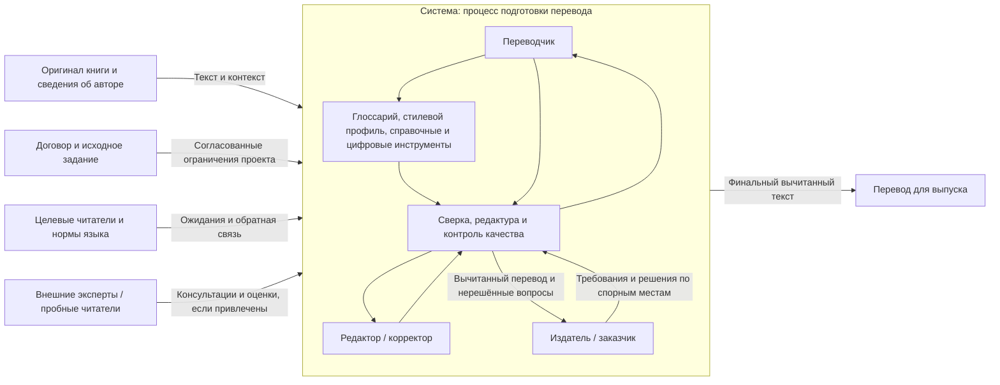

# Лабораторная работа 1. Границы и цель системы

## Рассматриваемая система

**Система:** работа над переводом книги на другой язык с сохранением смысла, авторского стиля и читабельности.

Это не будущая программа-переводчик, а действующий процесс, в котором переводчик, редактор и издатель/заказчик вместе превращают оригинал и требования к переводу в вычитанный и согласованный текст. Рассматривается путь от получения полного комплекта исходных материалов до выпуска финальной версии. Описание процесса пока является моделью по материалам лабораторной 2: фактические регламенты и наблюдения за конкретным проектом ещё нужно проверить.

## Граница системы

**Внутри:** переводчик, редактор и издатель/заказчик в части постановки требований, согласования спорных решений и приёмки; подготовка черновика, сверка с оригиналом, редактирование и выпуск текста; глоссарий, стилевой профиль и список замечаний; используемые справочные и цифровые инструменты.

**Среда, влияющая на систему:** автор и особенности оригинала; целевые читатели и нормы целевого языка; правообладатели и условия использования текста; внешние эксперты и пробные читатели, если к ним обращаются. Издательский рынок и работа издательства за пределами постановки задачи и приёмки не рассматриваются.

**Не включается в эту модель:** написание оригинальной книги, её печать и распространение, маркетинг и продажи. Они могут влиять на требования, но не относятся к работе над переводом до выпуска вычитанного текста.

**Спорные элементы границы:** издатель/заказчик включён в систему только в роли участника конкретного проекта — постановка требований, согласование и приёмка; остальные издательские процессы остаются снаружи. Целевые читатели влияют ожиданиями и обратной связью, но не управляют ежедневным переводом. Словари и цифровые инструменты считаются ресурсами процесса, а не самостоятельными участниками: ответственность за решение остаётся у людей.

## Контекстная диаграмма

Оригинал и требования по конкретному проекту поступают на вход процесса; после согласования издатель/заказчик участвует в нём как ответственная сторона за требования и приёмку.

## Заинтересованные стороны

| Сторона | Чего хочет от системы | Что для неё означает сбой |
| --- | --- | --- |
| Переводчик | Понятные требования, доступ к контексту и справочным материалам, время на качественную работу и согласование спорных мест | Неясные ожидания, переделки, срыв срока или ответственность за решения, которые нельзя было согласовать |
| Редактор / корректор | Точный и достаточно полный черновик, единые правила и возможность исправить ошибки до выпуска | Пропущенные смысловые ошибки, несогласованные термины и нехватка времени на проверку |
| Издатель / заказчик | Перевод, соответствующий задаче и аудитории, выпущенный в срок и в рамках бюджета | Жалобы читателей, дополнительные расходы, задержка выпуска или необходимость переиздания |
| Автор / правообладатель | Сохранение смысла и узнаваемых особенностей оригинала, корректное обращение с текстом | Искажение содержания или авторского голоса, нарушение прав |
| Целевые читатели | Естественный, понятный и последовательный текст, передающий содержание книги | Трудночитаемый перевод, смысловые ошибки или заметная непоследовательность |
| Внешний эксперт / пробный читатель (если привлечён) | Чёткая задача проверки и корректное использование замечаний | Его оценка не учитывается или используется без контекста и согласованных критериев |

## Цель и признаки её достижения

**Цель системы:** выпустить пригодный для целевой аудитории вычитанный перевод книги, который сохраняет содержание и узнаваемые особенности авторского стиля, читается естественно и укладывается в согласованные с заказчиком ограничения по сроку и стоимости.

В лабораторной 2 предложены следующие начальные критерии для пилота. Это **целевые пороги, а не измеренные результаты текущего процесса**; их нужно согласовать с заказчиком и проверить на конкретной книге.

| Признак | Как измерять | Предлагаемый порог |
| --- | --- | --- |
| Сохранение содержания | Число критических смысловых ошибок на 1 000 слов оригинала по результатам сверки редактором | Не более 1 |
| Полнота проверки | Доля текста, для которого зафиксирована проверка переводчиком или редактором | 100 % |
| Сходство авторского стиля | Слепая оценка выбранных фрагментов тремя экспертами по единой шкале 1–5 | Средняя оценка не ниже 4; не менее 80 % фрагментов получают 4 или выше |
| Естественность текста | Оценка выбранных фрагментов редакторами/читателями по шкале 1–5 | Средняя оценка не ниже 4 |
| Согласованность терминов | Доля корректных употреблений среди проверенных применимых терминов по утверждённому глоссарию | Не менее 98 % |
| Срок и стоимость | Календарные дни и фактические расходы от получения полного комплекта материалов до утверждения финального текста | Не превышают значения, согласованные для конкретной книги |

## Записка о цели и наблюдениях

Система нужна, чтобы довести исходный текст книги до вычитанного перевода, сохранив смысл, авторский стиль и удобство чтения. Успех нельзя сводить к факту передачи текста: его следует оценивать по результатам сверки с оригиналом, проверке стиля и естественности, согласованности терминов, полноте контроля, а также соблюдению согласованных срока и бюджета. Пороговые значения выше — гипотезы для пилота, а не подтверждённые характеристики существующего процесса. Для их проверки потребуются журнал проекта, глоссарий, редакторские замечания и независимые оценки фрагментов.

**Личное наблюдение при пробе машинного перевода:** я перевела машинным переводом свою любимую книгу «Гарри Поттер» и заметила, что, по моему впечатлению, характеры персонажей в переводе не были переданы. Это удивило меня, потому что при знакомстве с книгой для меня важны не только события, но и то, как через текст раскрываются персонажи. Этот пример основан на моём впечатлении от перевода; без указания конкретного фрагмента и сравнения с оригиналом он не позволяет определить, какие именно особенности характеров потерялись, и не доказывает, что так происходит в других переводах.

**Рассказ подруги о пробе машинного перевода:** подруга переводила машинным переводом научную статью, и результат её также не устроил. Меня удивило, что неудовлетворённость результатом возникла и при работе с научным текстом, а не только с художественной книгой. Конкретные ошибки или фрагменты пока не зафиксированы, поэтому этот рассказ не показывает, что именно оказалось неудачным.

Первый пример — личная проба перевода, второй — рассказ подруги; ни один из них не является наблюдением за работой переводчика или редактора в реальном проекте. Для критерия «три наблюдения» пока зафиксированы два примера; третий фактический пример нужно добавить после изучения конкретного процесса или разговора с его участником.

При сборе наблюдений стоит выяснить, как передаются требования к стилю, где фиксируются термины и спорные решения, кто принимает окончательный вариант и на каком этапе чаще всего возникают возвраты на доработку. Эти вопросы помогут проверить предложенную границу и цель на практике.
